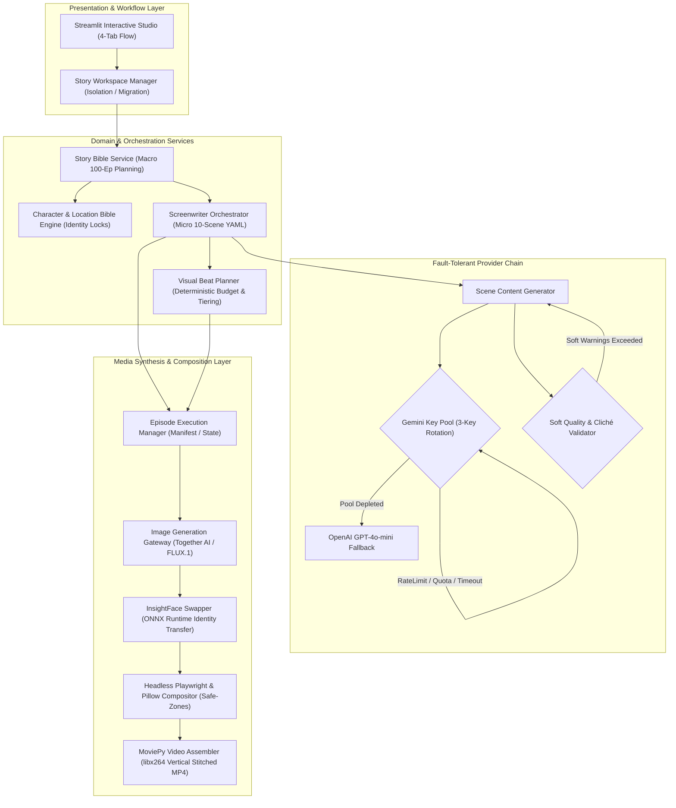

# AI-Powered Autonomous Video Production & Script Engine (Short-Form Drama Pipeline)

[Türkçe Versiyon (Turkish)](README_tr.md) | **English Version**

> **PROPRIETARY & PRIVATE PROJECT NOTICE**  
> **Notice:** This project is an independently engineered, closed-source personal software initiative. The complete implementation source code, neural orchestration scripts, model checkpoints, and workflow configs are maintained in a secure **private repository** and are not made publicly accessible for intellectual property protection. This public repository serves as an architectural whitepaper, technical showcase, and interface specification demonstrating the software engineering patterns, system resilience, and pipeline design. The codebase cannot be directly cloned or downloaded from this repository.

---

## Executive Architectural Summary

The **Autonomous Video Production Engine** is a high-performance automated pipeline designed to generate continuous, high-fidelity, vertical (9:16) episodic drama series for digital media platforms. Integrating multi-agent generative intelligence, state-machine story management, deterministic budget scheduling, face identity persistence, and headless GPU/CPU rendering, the platform converts high-level conceptual prompts into fully composed, production-ready cinematic episodes.

The platform embodies modern software craftsmanship principles:
* **Clean & Layered Architecture**: Clear separation of concerns spanning the Domain, Application Orchestration, Provider Adapters, and Rendering Infrastructure.
* **Resilient Multi-Provider Fallbacks**: Self-healing LLM pipelines with quota-aware multi-key rotation and cross-provider failovers (Google Gemini 2.5/1.5 $\rightarrow$ OpenAI GPT-4o-mini).
* **Idempotent Operations & Deterministic Visual Budgeting**: A zero-LLM post-processing planner allocating compute tiers (`pro` vs. `economy` vs. `reused`) to enforce strict cost ceilings and visual pacing without state mutation side-effects.
* **Deterministic Fallback Recovery & Provenance Tracking**: Multi-layered content fallback schemas accompanied by forensic metadata tracking (`_visual_prompt_source`, `_image_decision_reason`) to ensure traceable outputs across every frame.

---

## High-Level System Architecture

The following Mermaid diagram maps the end-to-end event flow, dependency inversion, and pipeline stages across the system's operational domains:



---

## Architectural Pillars

### 1. Clean & Decoupled Domain Architecture
The solution isolates business logic from external API contracts and I/O frameworks:
* **Domain Layer**: Defines entities (`SceneRequest`, `RenderedScene`, `StoryWorkspace`, `PlannerBudget`, `BubbleStyle`, `OverlayStyle`).
* **Application Services**: Coordinates macro story arcs (`story_bible.py`), scene structuring (`screenwriter.py`), and asset lifecycle orchestration (`episode_manager.py`).
* **Adapter / Gateway Layer**: Encapsulates external vendor protocols into standard interfaces (`image_generator.py` wrapping Together AI, `scene_content_generator.py` wrapping Gemini/OpenAI, `compositor.py` wrapping Playwright).
* **Infrastructure Layer**: Filesystem persistence, ONNX execution engine, headless Chromium browser, and video encoding drivers.

### 2. Multi-Tier Fallback & Key Rotation Mechanism
Generative pipelines must resist external API throttling, billing exhaustion, and localized network hiccups. The system incorporates an autonomous failure-mitigation ladder:
* **Key Pool Health Monitoring**: Active round-robin and sequential rotation across multiple Gemini API keys (`GEMINI_API_KEY_1..3`). Keys flagged as exhausted (`429 Too Many Requests`, `402 Billing`, or `403 Quota`) are transparently isolated without interrupting execution.
* **Cross-Provider Failover**: If the primary Gemini pool is exhausted or encounters unrecoverable structural errors, the pipeline triggers a zero-interruption failover to OpenAI (`gpt-4o-mini`).
* **Graceful Degradation (Fail-Open Structure)**: In the rare event that all external providers fail or credentials are omitted, the screenwriter's deterministic baseline prompts (`scene_production_prompt` fallbacks) are dynamically activated, ensuring the rendering engine never starves.

### 3. Idempotent Execution & Deterministic Visual Beat Planning
* **Zero-Cost Algorithmic Pacing**: The `VisualBeatPlanner` executes pure algorithmic post-processing on scene structures without making LLM calls. It clusters contiguous scenes into semantic beats based on character presence, framing transitions, and location continuity.
* **Deterministic Budget Enforcement**: Assigns image tiers (`pro` vs. `economy` vs. `reused`) using strict mathematical constraints (e.g., maximum 3 `pro` renders per episode, minimum 45% reuse ratio, maximum 2 consecutive identical visual anchors).
* **Idempotency**: Re-running the pipeline on an existing scenario produces byte-identical visual assignments, preventing unwanted budget inflation or erratic pacing changes.

### 4. Quality Validation & Heuristic Circuit Breakers
* **Soft Heuristic Validators**: Inspects generated visual and narrative prompts using language distribution heuristics (ASCII dominance for visual rendering engines; localized Turkish glyph and stopword validation for dialogue).
* **Cliché Mitigation & Quality Retries**: A weighted evaluation filter detects structural clichés and forbidden narrative archetypes in overlay texts. When soft warnings hit defined thresholds ($\ge 2$), the generation executes an immediate single-shot retry with negative exemplar injection.

---

## Core Component Blueprint

| Module | Architectural Role | Key Responsibilities |
| :--- | :--- | :--- |
| `src/story_workspace.py` | Workspace Isolation & Migration | Multi-series workspace sandboxing, slugification, index cataloging, legacy schema migration. |
| `src/story_bible.py` | Macro Narrative Synthesis | Long-form story arc generation, multi-season/multi-episode narrative trajectory, worldbuilding constraints. |
| `src/character_bible_generator.py` | Entity State Management | Forensic character modeling, wardrobe profiles, `identity_lock` definition, dynamic state timelines. |
| `src/screenwriter.py` | Episode Orchestrator | Micro-beat decomposition (10 scenes/ep), context compression, camera safe-zone enforcement, prompt architecture. |
| `src/scene_content_generator.py` | Dual-Tier Prompt Synthesizer | Multi-provider rotation engine, English visual prompt generation, Turkish emotional overlay synthesis. |
| `src/visual_beat_planner.py` | Algorithmic Resource Allocator | Zero-LLM visual clustering, pro-tier budget enforcement, consecutive reuse limits, cost reporting. |
| `src/image_generator.py` | Diffusion Gateway | FLUX.1 model synthesis via Together AI, aspect ratio normalization (768x1344 $\rightarrow$ 1080x1920), face swap pre-processing. |
| `src/face_swap.py` | Biometric Continuity Adapter | Local InsightFace ONNX execution (`inswapper_128`), source face extraction, canonical identity persistence. |
| `src/compositor.py` | Headless Visual Compositor | Dual-layer typesetting: top safe-zone cinematic narrative overlays + Playwright headless HTML/CSS speech bubbles. |
| `src/video_generator.py` | Media Assembly Engine | MoviePy sequence compilation, staggered clip transitions (crossfading), vertical 9:16 MP4 encoding (libx264). |
| `src/episode_manager.py` | Execution Facade | End-to-end pipeline coordination, manifest tracking (`manifest.json`), UI progress reporting. |

---

## Logical API Interface Specifications

Although exposed locally via a custom Streamlit studio, the pipeline is organized as modular, programmatically consumable Python service endpoints:

### 1. Macro Story Arc & Worldbuilding
```
Endpoint: StoryBible.generate_macro_plan(concept: str, seasons: int, episodes_per_season: int) -> MacroPlan
```
* **Payload**: High-level Turkish drama concept, total season count, target episode density.
* **Output**: Hierarchical season/episode outline, overarching dramatic conflicts, character roster.
* **Error Semantics**: Retries on truncated JSON tokens; fails back to deterministic skeletal outlines.

### 2. Episodic Scenario Structuring
```
Endpoint: Screenwriter.write_episode(story_slug: str, season: int, episode: int, premise: str) -> EpisodeScenario
```
* **Payload**: Story identifier, season/episode coordinates, narrative premise.
* **Output**: YAML-compliant 10-scene scenario including framing metadata, speaker targets, camera directions, and `scene_production_prompt`.
* **Validation**: Enforces top-safe-zone text constraints, canonical location checks, and chronology continuity.

### 3. Scene Content Synthesis (Visual & Emotional Overlay)
```
Endpoint: SceneContentGenerator.generate_scene_content(prompt_bundle: ProductionPrompt) -> SceneContentResponse
```
* **Payload**: Context-compressed character specs, location continuity, target emotional tone.
* **Output**:
  * `visual_prompt`: Highly descriptive, text-free English visual diffusion prompt.
  * `overlay_text`: Punchy, indirect, Turkish cinematic overlay caption.
* **Resilience**: 3-Key Gemini rotation $\rightarrow$ OpenAI failover $\rightarrow$ deterministic screenwriter fallback.

### 4. Deterministic Budget & Visual Beat Planning
```
Endpoint: VisualBeatPlanner.plan(episode_dict: dict, budget: PlannerBudget) -> PlannedEpisodePlan
```
* **Payload**: Scenario dictionary, per-episode budget caps (`max_pro_images`, `min_reuse_ratio`).
* **Output**: Augmented scenario annotated with `visual_beat_id`, `requires_new_image`, `reuse_visual_from`, `image_model_tier`, and a comprehensive cost audit.

### 5. Media Synthesis & Composition
```
Endpoint: EpisodeManager.render_episode(story_slug: str, season: int, episode: int, progress_hook: Callable) -> EpisodeResult
```
* **Payload**: Story slug, episode identifier, progress event handler.
* **Output**: Output folder bundle containing raw diffusion frames, face-swapped intermediate assets, final HTML-composited 1080x1920 PNG frames, and `manifest.json`.

### 6. Video Compilation
```
Endpoint: VideoGenerator.render_episode_video(manifest_or_result: Union[EpisodeResult, Path], output_path: Path) -> Path
```
* **Payload**: Path to validated `manifest.json` or in-memory `EpisodeResult`.
* **Output**: Exported vertical MP4 (`1080x1920`, 30 FPS, H.264, staggered crossfade transitions).

---

## Fault Tolerance & Resilience Matrix

The engine implements systematic safeguards across every processing boundary:

| Failure Mode | Detection Vector | Automated Mitigation Strategy |
| :--- | :--- | :--- |
| **LLM Quota Depletion / Throttling** | HTTP 429, 402, or 403 quota string | Mark active key as exhausted; transparently rotate to next key in pool; log health state. |
| **All Primary LLM Keys Exhausted** | Pool exhaustion exception | Automatically route payload to fallback secondary provider (OpenAI `gpt-4o-mini`). |
| **Total Provider Service Outage** | Network timeout / 5xx server errors | Fail-open strategy: fall back to screenwriter's deterministic default prompts; append audit flags. |
| **Malformed Provider Output (JSON)** | Schema validation failure | Deterministic regex extractor strips Markdown code fences; triggers retry before provider failover. |
| **Cliché / Low-Quality Overlay Output** | Soft heuristic score $\ge$ threshold | Single-shot retry with rejected text explicitly injected as a negative style constraint. |
| **Diffusion Server Failure / Missing Key** | HTTP 5xx / Unset Together AI Token | Safe graceful termination; aborts rendering step while preserving scenario and planning manifests. |
| **Face Detection Failure** | InsightFace 0-face detection | Silent fallback: original generated diffusion frame is retained unchanged without pipeline termination. |
| **Missing Canonical Face Reference** | Filesystem lookup miss | Bypasses biometric swap stage automatically; logs notice in asset manifest. |
| **Headless Browser Render Timeout** | Playwright process timeout | Process isolation restart; re-attempts HTML bubble rasterization before fatal error raising. |

---

## Data Flow & Storage Topology

```
story_bible/
└── {story_slug}/
    ├── index.yaml                  # Story registration & metadata
    ├── macro_plan.yaml             # 100-episode narrative roadmap
    ├── characters.yaml             # Character identities, wardrobe & facial references
    ├── locations.yaml              # Canonical locations & environmental constraints
    └── episodes/
        ├── s01_e01.yaml            # Render-ready scenario script & beat allocation
        └── s01_e02.yaml
output/
└── {story_slug}/
    └── s01_e01/
        ├── raw/                    # Raw diffusion outputs from Together AI
        │   ├── scene_001_raw.png
        │   └── scene_002_raw.png
        ├── frames/                 # Composited final frames (Overlay + Speech Bubble)
        │   ├── scene_001.png
        │   └── scene_002.png
        ├── manifest.json           # Comprehensive scene metadata & provenance audit
        └── s01_e01_final.mp4       # Final assembled 9:16 vertical video
```

---

## Technical Specifications

* **Runtime Target**: Python 3.10+ (Standard Unix / Windows Execution Environment)
* **Core Libraries**: Streamlit, Playwright Headless Chromium, Pillow, OpenCV, NumPy, ONNX Runtime, MoviePy.
* **Video Standard**: H.264 / libx264, 1080x1920 (9:16 Portrait), 30.0 FPS, YUV420p color matrix.
* **Biometric Model**: InsightFace `inswapper_128.onnx` (ONNX Runtime Execution Engine).
* **Diffusion Backend**: FLUX.1 (`FLUX.1.1-pro` / `FLUX.1-schnell-Free`) via Together AI HTTP API.
* **LLM Engine**: Google Gemini 2.5/1.5 Flash (Primary Tier) + OpenAI GPT-4o-mini (Failover Tier).

---

## Project Status & Availability Notice

This repository contains public interface definitions, architectural schematics, and system design whitepapers for portfolio showcase and technical evaluation purposes. The implementation source code, trained ONNX weights, and automated production pipelines are maintained exclusively in a private repository.

Direct downloading, automated scraping, or unauthorized redistribution of this architecture documentation is not permitted. For technical inquiries or developer collaboration, please reach out via GitHub.
