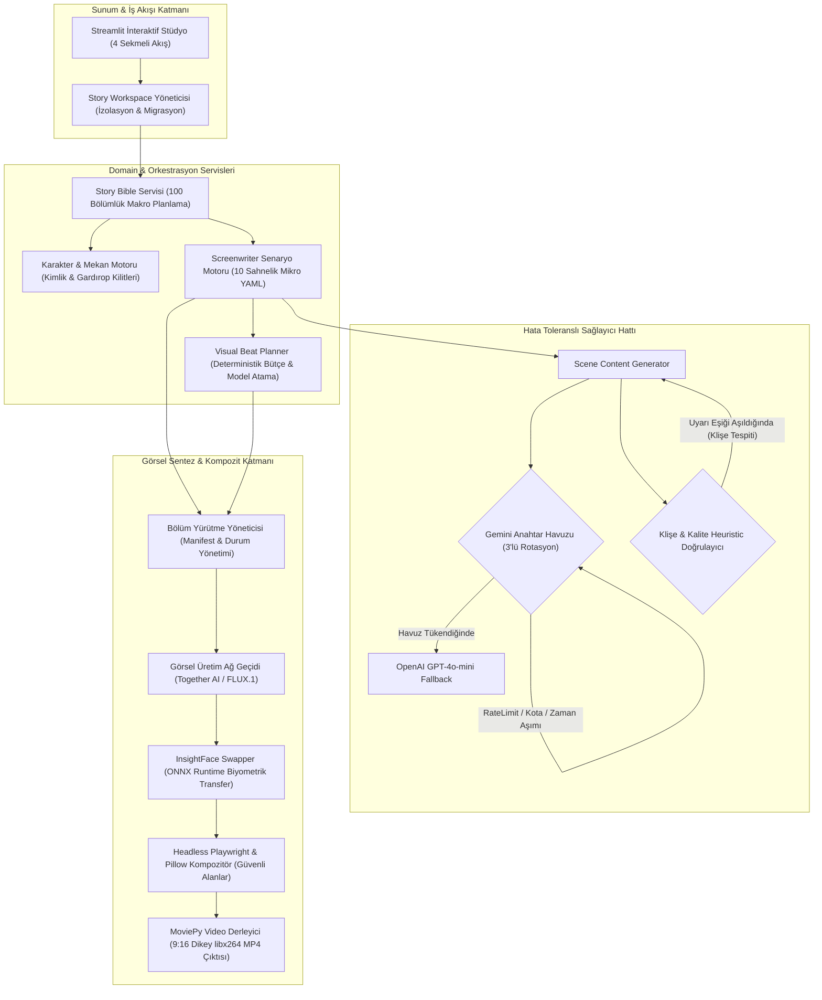

# Yapay Zeka Destekli Otonom Dizi & Video Üretim Motoru (Dikey Format Drama Hattı)

**Türkçe Versiyon** | [English Version (İngilizce)](README.md)

> **KİŞİSEL PROJE VE GİZLİLİK BİLDİRİMİ**  
> **Önemli Not:** Bu proje, bağımsız olarak geliştirilmiş kapalı kaynaklı (closed-source) kişisel bir yazılım projesidir. Projenin tam kaynak kodları, sinirsel orkestrasyon betikleri, model ağırlıkları ve iş akışı yapılandırmaları; fikri mülkiyet ve telif koruması amacıyla **özel (private) bir depoda saklanmaktadır**. İşbu genel (public) dokümantasyon; projenin sistem mimarisini, Clean Architecture prensiplerini, fallback (yedekleme) mekanizmalarını ve hata toleransı derinliğini ortaya koymak amacıyla hazırlanmış bir teknik portfolyo ve mimari şartnamedir. Kod tabanı doğrudan bu depodan indirilemez veya klonlanamaz.

---

## Yönetici Özeti ve Mimari Vizyon

**Otonom Video Üretim Motoru**, dijital platformlar için yüksek kaliteli, 9:16 dikey formatta kısa dramatik dizi bölümleri üreten yeni nesil bağımsız bir üretim hattıdır. Sistem; çoklu yapay zeka ajanları, durum makineleri (state machines), deterministik bütçe planlayıcıları, biyometrik yüz tutarlılığı (face swap) ve headless grafik kompozisyon bileşenlerini tek bir çatı altında birleştirir.

Sistemin temel mühendislik ilkeleri:
* **Clean & Katmanlı Mimari (Clean Architecture)**: Domain, Uygulama Orkestrasyonu, Servis Adaptörleri ve Altyapı katmanları arasında kesin sorumluluk ayrımı.
* **Yüksek Hata Toleranslı Fallback Zincirleri**: Kota tükenmesi ve hız sınırlamalarına (rate limit) karşı çoklu anahtar rotasyonu ve sağlayıcılar arası otomatik geçiş (Gemini 2.5/1.5 $\rightarrow$ OpenAI GPT-4o-mini $\rightarrow$ Deterministik Şablonlar).
* **İdempotent İşlemler ve Deterministik Görsel Bütçeleme**: Sıfır-LLM maliyeti ile çalışan, bölümleri görsel beat'lere kümeleyen ve katı bütçe kurallarıyla (`pro`, `economy`, `reused`) model atayan matematiksel planlama modülü.
* **Uçtan Uca İzlenebilirlik (Provenance Tracking)**: Üretilen her kare ve metin için veri kaynağı damgalama (`_visual_prompt_source`, `_image_decision_reason`) ile tam denetlenebilirlik.

---

## Üst Düzey Sistem Mimarisi

Aşağıdaki Mermaid mimari diyagramı, sistem bileşenleri arasındaki veri akışını, bağımlılıkları ve hata toleransı hatlarını göstermektedir:



---

## Mimari Temeller ve Tasarım Prensipleri

### 1. Temiz ve Ayrık Mimari (Clean Architecture)
Sistem iş mantığı, harici API bağımlılıklarından ve I/O süreçlerinden tamamen yalıtılmıştır:
* **Domain Katmanı**: Çekirdek veri modelleri (`SceneRequest`, `RenderedScene`, `StoryWorkspace`, `PlannerBudget`, `BubbleStyle`, `OverlayStyle`).
* **Uygulama Katmanı**: Makro hikaye örgüleri (`story_bible.py`), senaryo yapılandırması (`screenwriter.py`) ve sahne render orkestrasyonu (`episode_manager.py`).
* **Adaptör / Ağ Geçidi Katmanı**: Harici sağlayıcıları soyutlayan arayüzler (Together AI için `image_generator.py`, LLM sağlayıcıları için `scene_content_generator.py`, render için `compositor.py`).
* **Altyapı Katmanı**: Yerel dosya sistemi hiyerarşisi, ONNX Runtime yürütücüsü, headless Chromium tarayıcısı ve FFmpeg tabanlı video motoru.

### 2. Çok Seviyeli Fallback ve Anahtar Rotasyonu
Üretim hatlarının harici API kesintilerine ve kota limitlerine dayanıklı olması için kademeli bir savunma mekanizması uygulanmıştır:
* **Dinamik Anahtar Havuzu**: `GEMINI_API_KEY_1..3` anahtarları arasında sağlık takibi ve otomatik rotasyon. Kota aşımı (`429`, `402`, `403`) tespit edildiğinde ilgili anahtar geçici olarak devre dışı bırakılır ve bir sonrakine geçilir.
* **Sağlayıcılar Arası Otomatik Geçiş**: Gemini havuzundaki tüm anahtarlar tükendiğinde, iş yükü şeffaf bir şekilde ikincil sağlayıcıya (`OpenAI gpt-4o-mini`) yönlendirilir.
* **Fail-Open ve Deterministik Kurtarma**: Ağ kesintisi veya tüm anahtarların tükenmesi durumunda sistem çökmek yerine, Screenwriter katmanının ürettiği deterministik temel prompt'ları devreye alarak görsel render aşamasının kesintisiz sürmesini garanti eder.

### 3. İdempotent Yapı ve Deterministik Görsel Bütçeleme (Visual Beat Planner)
* **Sıfır LLM Maliyetli Planlama**: `VisualBeatPlanner`, senaryo üretiminden sonra çalışan, hiçbir harici API çağrısı yapmayan saf algoritmik bir optimizasyon modülüdür.
* **Karakter ve Sahne Sürekliliği**: Karakter varlığı, kamera açısı ve mekan sürekliliğine göre sahneleri "görsel beat"lere ayırır.
* **Katı Bütçe Sınırları**: Her bölüme maksimum 3 adet `pro` görsel atar, minimum %45 görsel yeniden kullanım (reuse) oranı uygular ve ardışık en fazla 2 tekrar kuralını zorunlu kılar.
* **İdempotentlik**: Aynı senaryo üzerinde defalarca çalıştırıldığında yan etki üretmeksizin aynı deterministik planı ve maliyet tahminini üretir.

### 4. Kalite Heuristikleri ve Hata Ayıklama Devre Kesicileri
* **Çift Dilli Ayrım Denetimi**: Görsel modeller için İngilizce (`ASCII` ağırlıklı) prompt doğrulaması; diyalog ve anlatıcı katmanı için Türkçe karakter ve durak sözcük (stop-word) kontrolü.
* **Klişe Önleme ve Kendi Kendini Düzeltme (Quality Retry)**: Anlatıcı metinlerinde ("Aralarındaki sessizlik", "sorumluluğun ağırlığı" vb.) yapısal klişeleri ağırlıklı puanlarla tespit eden filtre. Eşik aşıldığında ($\ge 2$), hatalı çıktı "üretilmemesi gereken örnek" olarak modele geri beslenerek anında tek seferlik düzeltme çağrısı yapılır.

---

## Temel Modül Şartnamesi

| Modül | Mimari Rol | Temel Sorumluluk |
| :--- | :--- | :--- |
| `src/story_workspace.py` | Çalışma Alanı İzolasyonu | Çoklu hikaye yönetimi, slugification, dizin fihristi oluşturma ve eski şema migrasyonu. |
| `src/story_bible.py` | Makro Anlatı Sentezi | 100 bölümlük uzun soluklu dizi planlaması, sezon/bölüm örgüleri, evren kuralları. |
| `src/character_bible_generator.py` | Varlık Durum Yönetimi | Biyometrik `identity_lock`, varsayılan gardırop, durum zaman çizelgesi ve görsel referans haritası. |
| `src/screenwriter.py` | Bölüm Orkestratörü | 10 sahnelik mikro YAML üretimi, kamera açıları, güvenli metin alanı denetimi ve bağlam sıkıştırma. |
| `src/scene_content_generator.py` | Çift Katmanlı Prompt Üretimi | Gemini/OpenAI rotasyon motoru, İngilizce görsel prompt ve Türkçe duygusal iç ses (overlay) üretimi. |
| `src/visual_beat_planner.py` | Algoritmik Kaynak Dağıtıcı | Sıfır-LLM beat kümeleme, `pro`/`economy`/`reused` model dağıtımı, ardışık tekrar sınırlandırması. |
| `src/image_generator.py` | Görsel Üretim Ağ Geçidi | Together AI / FLUX.1 API entegrasyonu, 768x1344 $\rightarrow$ 1080x1920 en-boy optimizasyonu. |
| `src/face_swap.py` | Biyometrik Tutarlılık | InsightFace `inswapper_128.onnx` modeliyle karelerdeki karakter yüzlerini referans yüzle değiştirme. |
| `src/compositor.py` | Görsel Kompozitör | Üst güvenli alana yerleşen sinematik anlatıcı bandı ve Playwright tabanlı HTML/CSS konuşma balonları. |
| `src/video_generator.py` | Medya Derleyici | MoviePy ile sahneleri çapraz geçişlerle (crossfade) birleştirip 9:16 libx264 MP4 çıktısı alma. |
| `src/episode_manager.py` | Yürütme Cephesi (Facade) | Senaryodan MP4'e kadar tüm süreci yönetme, `manifest.json` kaydı ve arayüz ilerleme takibi. |

---

## Mantıksal API Uç Noktaları Tablosu

Sistem, yerel Streamlit stüdyosunun arkasında programatik olarak tüketilebilen modüler servis uç noktalarına sahiptir:

| Servis Fonksiyonu | Giriş Parametreleri (Payload) | Çıktı / Yanıt Modeli | Hata Semantiği & Tolerans |
| :--- | :--- | :--- | :--- |
| `StoryBible.generate_macro_plan` | `concept: str`, `seasons: int`, `episodes_per_season: int` | `MacroPlan` (Sezon ve bölüm dökümleri, çatışma haritası) | JSON eksikliklerinde deterministik düzeltme; başarısızlıkta şablon iskelete düşüş. |
| `Screenwriter.write_episode` | `story_slug: str`, `season: int`, `episode: int`, `premise: str` | `EpisodeScenario` (10 sahnelik doğrulanmış YAML sözlüğü) | Bilinmeyen karakterde hata fırlatır; geçersiz mekanlarda en yakın geçerli mekana fallback yapar. |
| `SceneContentGenerator.generate_scene_content` | `prompt_bundle: ProductionPrompt` | `SceneContentResponse` (`visual_prompt`, `overlay_text`) | Gemini (3 Key) $\rightarrow$ OpenAI $\rightarrow$ Screenwriter fallback; asla çağıranı bloke etmez. |
| `VisualBeatPlanner.plan` | `episode_dict: dict`, `budget: PlannerBudget` | `PlannedEpisodePlan` (Tier etiketli sahneler, bütçe raporu) | Pure deterministic fonksiyon; veri hatasında güvenli `economy` moduna geçer. |
| `EpisodeManager.render_episode` | `story_slug: str`, `season: int`, `episode: int`, `progress_cb: Callable` | `EpisodeResult` (Raw kareler, final kareler, `manifest.json`) | Biyometrik yüz bulunamazsa raw kare korunur; görsel üretim hatasında süreci güvenle durdurur. |
| `VideoGenerator.render_episode_video` | `manifest_or_result: Union[EpisodeResult, Path]`, `output_path: Path` | `Path` (Derlenmiş 1080x1920 dikey MP4 dosyası) | Eksik kare tespitinde doğrulama hatası fırlatır; MoviePy iş parçacığı havuzunu güvenle kapatır. |

---

## Hata Toleransı ve Dayanıklılık Matrisi

| Hata / İstisna Türü | Tespit Yöntemi | Otomatik İyileştirme & Savunma Mekanizması |
| :--- | :--- | :--- |
| **LLM Kota Aşımı (Quota Exceeded)** | HTTP 429, 402 veya 403 hata kodu | Aktif anahtar tükenmiş olarak etiketlenir, havuzdaki bir sonraki geçerli anahtara geçilir. |
| **Tüm Gemini Anahtarlarının Tükenmesi** | Anahtar havuzunun boş kalması | İş yükü kesintisiz olarak ikincil sağlayıcıya (`OpenAI gpt-4o-mini`) yönlendirilir. |
| **Genel LLM Servis Kesintisi** | Ağ zaman aşımı (Timeout) / 5xx HTTP hataları | Fail-open stratejisi: Screenwriter tarafından üretilmiş deterministik yedek prompt'lar kullanılır. |
| **Bozuk LLM JSON Yanıtı** | Şema ve JSON ayrıştırma hatası | Regex tabanlı kod bloğu temizleyicisi çalıştırılır; başarısız olursa sonraki sağlayıcı denenir. |
| **Zayıf / Klişe Metin Çıktısı** | Ağırlıklı klişe sözlük taraması $\ge 2$ | Üretilen kötü metin "üretilmemesi gereken stil" olarak prompt'a eklenip tek seferlik yeniden üretilir. |
| **Görsel API Hatası / Eksik Token** | HTTP 5xx / Eksik Together AI anahtarı | Süreç güvenli şekilde durdurulur; yazılmış senaryo ve planlama manifestoları korunur. |
| **Karede Yüz Bulunamaması** | InsightFace 0-yüz tespiti | Fallback devrededir: Orijinal FLUX karesi bozulmadan korunur ve işlem sonraki adıma geçer. |
| **Eksik Biyometrik Referans Görseli** | Dosya sistemi arama eksikliği | Biyometrik swap adımı sessizce atlanır, manifesto dosyasına bilgi notu düşülür. |
| **Headless Tarayıcı Kilitlenmesi** | Playwright sayfa render zaman aşımı | Tarayıcı örneği izole edilerek yeniden başlatılır; başarısız sahnede render tekrar denenir. |

---

## Veri Akışı ve Dizin Topolojisi

```
story_bible/
└── {story_slug}/
    ├── index.yaml                  # Seri tescil ve üstveri kütüğü
    ├── macro_plan.yaml             # 100 bölümlük anlatı yol haritası
    ├── characters.yaml             # Karakter biyografileri, gardırop ve yüz referansları
    ├── locations.yaml              # Kanonik mekanlar ve görsel kısıtlar
    └── episodes/
        ├── s01_e01.yaml            # Render-ready senaryo ve beat atamaları
        └── s01_e02.yaml
output/
└── {story_slug}/
    └── s01_e01/
        ├── raw/                    # Together AI ham üretimleri
        │   ├── scene_001_raw.png
        │   └── scene_002_raw.png
        ├── frames/                 # Nihai kompozit kareler (Anlatıcı + Konuşma Balonu)
        │   ├── scene_001.png
        │   └── scene_002.png
        ├── manifest.json           # Ayrıntılı sahne denetim ve köken (provenance) raporu
        └── s01_e01_final.mp4       # Montajlanmış nihai 9:16 dikey video
```

---

## Teknik Spesifikasyonlar

* **Çalışma Ortamı**: Python 3.10+ (Standart Linux / Windows Çalışma Ortamı)
* **Kritik Kütüphaneler**: Streamlit, Playwright Headless Chromium, Pillow, OpenCV, NumPy, ONNX Runtime, MoviePy.
* **Video Standardı**: H.264 / libx264, 1080x1920 (9:16 Dikey Portre), 30.0 FPS, YUV420p renk matrisi.
* **Biyometrik Model**: InsightFace `inswapper_128.onnx` (ONNX Runtime Yürütme Motoru).
* **Görsel Difüzyon**: FLUX.1 (`FLUX.1.1-pro` / `FLUX.1-schnell-Free`) - Together AI API Gateway.
* **Doğal Dil Modelleri**: Google Gemini 2.5/1.5 Flash (Birincil Seviye) + OpenAI GPT-4o-mini (Fallback Seviyesi).

---

## Proje Durumu ve Erişim Bilgilendirmesi

Bu açık erişimli repository yalnızca mimari inceleme, sistem tasarımı değerlendirmesi ve portfolyo vitrini amacıyla paylaşılmıştır. Uygulama kaynak kodları, eğitilmiş ONNX model ağırlıkları ve tam otomatik üretim pipeline'ı geliştiriciye ait özel (private) bir repository altında tutulmaktadır.

Bu depodaki mimari tasarım dokümanlarının izinsiz otomatik toplanması veya ticari amaçla taklit edilmesi sınırlandırılmıştır. Teknik sorularınız veya iş birliği talepleriniz için GitHub üzerinden iletişime geçebilirsiniz.
